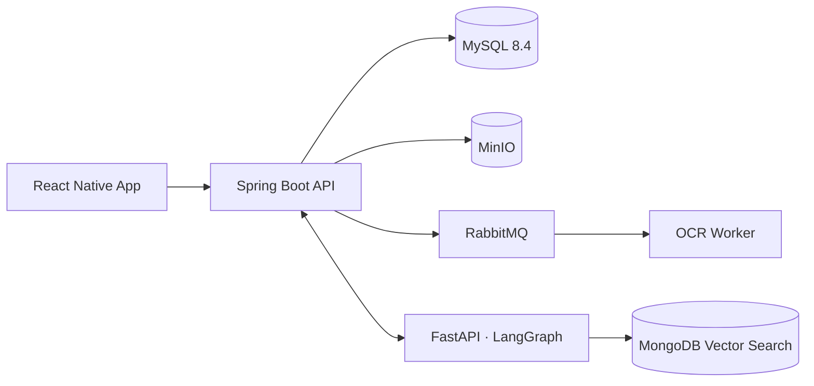

# 신한걸음 (Shinhan Step)

> 국내 거주 외국인의 금융생활 안정과 금융·체류 성장을 돕는 AI 에이전트 서비스

신한커리어넥스트 최종 팀 프로젝트 · 2026.10 ~ 2026.11.27

---

## 해결하려는 문제

한국에서 일하는 외국인 근로자는 언어 장벽, 낯선 금융 제도, 흩어진 체류 정보 때문에
급여·송금·저축 계획과 체류자격 준비를 함께 세우기 어렵습니다.

신한걸음은 사용자의 실제 금융 흐름과 체류 정보를 바탕으로,
**지금 얼마를 모을 수 있는지**와 **다음 체류 단계를 위해 무엇을 준비해야 하는지**를 함께 안내합니다.

## 주요 기능

| 기능 | 설명 |
|---|---|
| 온보딩 | 언어 선택, 외국인등록증 OCR, 마이데이터 연결 동의, 금융 목표·필수 확보액 입력 |
| 금융 분석 | 소득·지출·본국 송금을 분석해 월 여유자금 계산 (수치는 코드로 계산) |
| 비자 성장 로드맵 | 현재 체류자격과 공식 요건을 바탕으로 다음 체류 단계와 준비사항 안내
| AI 금융비서 | 도구 호출로 실제 분석 결과·체류 정보·정책 문서를 조회해 답하는 다국어 챗봇 |
| 정책 검색 | 정부 공식 문서 기반 체류 정책 검색, 출처·시행일 표시 |

## 아키텍처

## 기술 스택

| 영역 | 기술 |
|---|---|
| Frontend | React Native |
| Backend | Java 21, Spring Boot, Spring Security, JWT, JPA |
| AI | Python, FastAPI, LangGraph, Tool Calling, RAG, OCR |
| Data | MySQL 8.4, MongoDB Vector Search, MinIO |
| Infra | RabbitMQ, Docker Compose |

## 저장소

| 저장소 | 내용 |
|---|---|
| `hanstep-frontend` | React Native 앱 |
| `hanstep-backend` | Spring Boot API, DB 스키마 |
| `hanstep-AI` | AI 에이전트, OCR, RAG |
